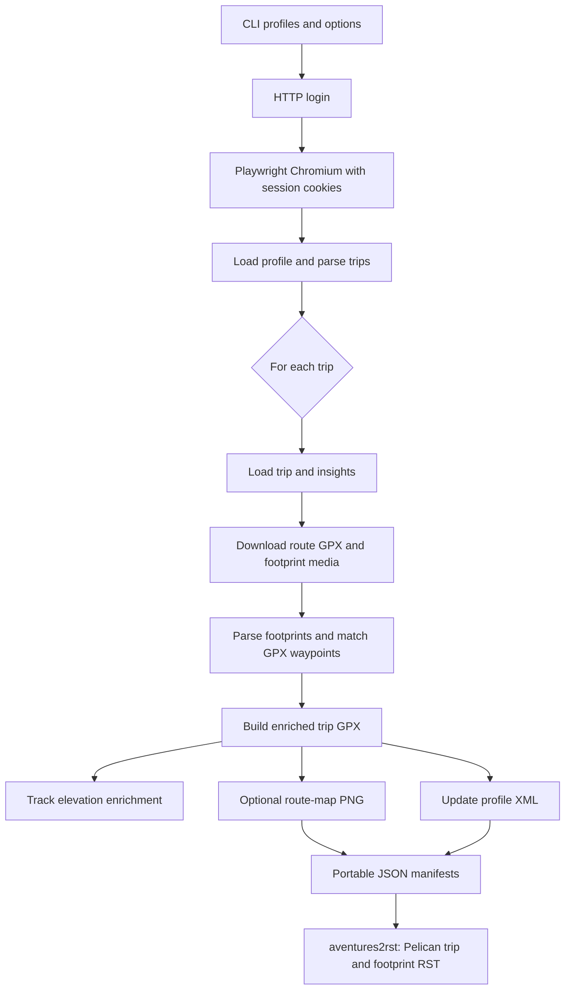

# scrapers Architecture

This document describes the current data flow and generated outputs.

## Goals

- Authenticate and load dynamic FindPenguins profile, trip and footprint pages.
- Save profile/trip data and downloaded media locally.
- Generate a profile XML index and an enriched GPX file per trip.
- Generate Pelican RST articles for trips and footprints.

## Main Components

- `scrapers.py`: CLI argument parsing and program dispatch.
- `findpenguins.py`: archive orchestration.
- `output_safety.py`: guards for `--force` directory clearing and path components (trip slugs).
- `fp_archive.py`: portable per-profile and per-trip JSON manifests.
- `aventures2rst.py`: independent archive-to-Pelican conversion.
- `reminder.py` / `reminders2rst.py`: `rem export` JSON export and per-reminder Pelican articles.
- `fp_config.py`: site endpoints, request headers and XML namespaces.
- `fp_utils.py`: login, Playwright setup, page loading, downloads and serialization helpers.
- `fp_parsers.py`: profile, trip, insight and footprint extraction.
- `fp_writers.py`: XML/GPX serialization, Pelican RST articles and route-map WebP images.
- `fp_elevation.py`: OpenTopoData SRTM90m enrichment for GPX track-point elevations.

## Runtime Data Flow

The profile and trip parsers collect data into dictionaries. The writers serialize those
dictionaries to the requested output formats. A failure processing one trip is logged and does
not normally stop the remaining trips.

## Output Layout

For profile id `<uid>`, the primary archive is written under `--output`:

- `<output>/<uid>/<uid>.xml`: profile and trip index.
- `<output>/<uid>/profile.json` and `<output>/<uid>/<trip-slug>/trip.json`: manifests used by the independent converter.
- `<output>/<uid>/<trip-slug>.gpx`: enriched route and footprint waypoints.
- `<output>/<uid>/<trip-slug>/`: downloaded route source, trip image, footprint photos/videos,
  optional fetched HTML, and `map_trip.webp` plus `satellite_trip.webp` when a valid
  route is available and the satellite imagery request succeeds.

The converter writes Pelican articles under `--content` (default
`../website/content/articles/findpenguins`): `<content>/<uid>/<trip-slug>/trip.rst` and one
`footprint_N/footprint.rst` per footprint. Media and maps are copied beside the sources. The trip
article has `Category: findpenguins`, `Template: findpenguins_trip` and `Date` (first footprint), `EndDate` (last footprint plus its nights) and `Transport` metadata; trip tags are `findpenguins`, `trip` and the countries, and footprint tags include `footprint`; the
website builds its trip index and book from these articles without generating standalone
footprint pages.

All downloaded and generated images are stored as lossless WebP; videos are untouched.

Route maps are 1200×800 WebP images with a white route line. The default background is transparent;
`satellite` and `street` backgrounds use Esri's export service. Footprint bubbles are opt-in.
Trips without a valid GPX track do not get a route map.

## Design Decisions

- Keep parser logic separate from serialization.
- Keep media paths in the JSON manifests relative to the archive root so archives can be moved.
- Treat downloaded GPX track geometry as the route source of truth; regenerate waypoints from
  footprints and preserve the track elements.
- Add each coordinate-bearing footprint as a waypoint, with additional FindPenguins fields in
  GPX extensions.
- Keep the profile XML index lightweight: trips refer to their GPX file and include companion
  metadata.
- Omit unavailable optional fields and continue after isolated trip-level failures.

## Extensibility

- Add extraction logic in `fp_parsers.py`.
- Map new fields to XML, GPX, HTML or RST in `fp_writers.py`.
- Add CLI behavior in `scrapers.py` and FindPenguins orchestration in `findpenguins.py`.
- Every function is documented in [`api-reference.md`](./api-reference.md); keep it in sync with the
  Doxygen-style docstrings (`! @brief`, `@param`, `@return`) when adding or changing functions.
- Update [`data-fields.md`](./data-fields.md) and [`xml-gpx-structure.md`](./xml-gpx-structure.md)
  when changing exported fields or schemas.
