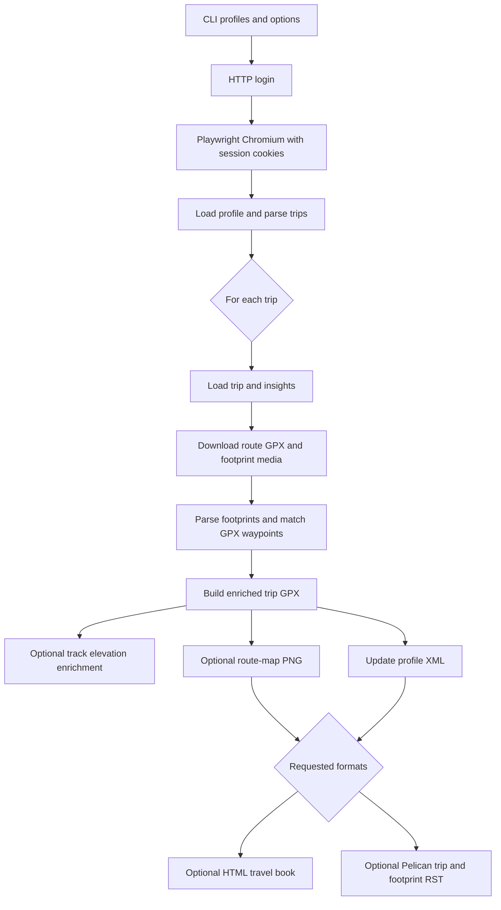

# FindPenguinsScrapper Architecture

This document describes the current data flow and generated outputs.

## Goals

- Authenticate and load dynamic FindPenguins profile, trip and footprint pages.
- Save profile/trip data and downloaded media locally.
- Generate a profile XML index and an enriched GPX file per trip.
- Optionally generate a standalone HTML travel book and Pelican RST sources.

## Main Components

- `findpenguins_scrapper.py`: CLI, orchestration and output generation.
- `fp_config.py`: site endpoints, request headers and XML namespaces.
- `fp_utils.py`: login, Playwright setup, page loading, downloads and serialization helpers.
- `fp_parsers.py`: profile, trip, insight and footprint extraction.
- `fp_writers.py`: XML/GPX serialization, HTML travel books, Pelican RST pages and route-map PNGs.
- `fp_elevation.py`: optional OpenTopoData SRTM90m enrichment for GPX track-point elevations.

## Runtime Data Flow

The profile and trip parsers collect data into dictionaries. The writers serialize those
dictionaries to the requested output formats. A failure processing one trip is logged and does
not normally stop the remaining trips.

## Output Layout

For profile id `<uid>`, the primary archive is written under `--output`:

- `<output>/<uid>/<uid>.xml`: profile and trip index.
- `<output>/<uid>/<trip-slug>.gpx`: enriched route and footprint waypoints.
- `<output>/<uid>/<trip-slug>/`: downloaded route source, trip image, footprint photos/videos,
  optional fetched HTML, and `map_trip.png` when a valid route is available.

Optional HTML (`--html PATH`) writes profile and trip-book pages under
`<PATH>/<uid>/`; one trip `index.html` and one `etape_N.html` are generated per trip.
When more than one profile is scraped, a global `index.html` is also generated at `<PATH>`.
The interactive maps use Leaflet and OpenStreetMap tiles, so they require network access.

Optional Pelican RST (`--rst PATH`) writes `<PATH>/<uid>/<trip-slug>/trip.rst` and one
`footprint_N/footprint.rst` per footprint. Media and maps are copied beside the generated
sources. No user/profile RST page or global FindPenguins index is generated; the website is
responsible for building its trip index from the trip-page metadata.

Route maps are 1200×800 PNGs with a white route line. The default background is transparent;
`satellite` and `street` backgrounds use Esri's export service. Footprint bubbles are opt-in.
Trips without a valid GPX track do not get a route map.

## Design Decisions

- Keep parser logic separate from serialization.
- Treat downloaded GPX track geometry as the route source of truth; regenerate waypoints from
  footprints and preserve the track elements.
- Add each coordinate-bearing footprint as a waypoint, with additional FindPenguins fields in
  GPX extensions.
- Keep the profile XML index lightweight: trips refer to their GPX file and include companion
  metadata.
- Omit unavailable optional fields and continue after isolated trip-level failures.

## Extensibility

- Add extraction logic in `fp_parsers.py`.
- Map new fields to XML, GPX, HTML or RST in `fp_writers.py`.
- Add CLI behavior and orchestration in `findpenguins_scrapper.py`.
- Update [`data-fields.md`](./data-fields.md) and [`xml-gpx-structure.md`](./xml-gpx-structure.md)
  when changing exported fields or schemas.
